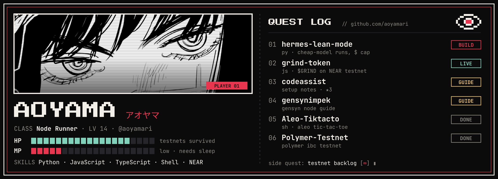

  

### hi, Aoyama here 👋

enthusiast. i run testnet nodes, write setup guides for them, and lately i've been building small things around AI agents and on-chain mechanics.
find me on X → [@callmeaoyama](https://x.com/callmeaoyama)

---

#### 🟢 Live
- [**grind-token**](https://github.com/aoyamari/grind-token) — $GRIND, a NEP-141 memecoin on NEAR where the meme is the mechanic: burn on transfer, agent staking, peer slashing, weekly ritual. running on testnet as `grind-token.testnet`.

#### 🛠️ Building
- [**hermes-lean-mode**](https://github.com/aoyamari/hermes-lean-mode) — Hermes Agent plugin: run tasks on a cheap model with a dollar cap, auto-escalation, and an honest cost receipt.

#### 📘 Node guides
- [**codeassist**](https://github.com/aoyamari/codeassist) — step-by-step setup for running Gensyn's CodeAssist on a VPS (Docker, uv, tunnels).
- [**gensynimpek**](https://github.com/aoyamari/gensynimpek) — Gensyn node guide (Indonesian).

#### 🗂️ Past builds
- [**Aleo-Tiktacto**](https://github.com/aoyamari/Aleo-Tiktacto) — my Aleo tic-tac-toe.
- [**Polymer-Testnet**](https://github.com/aoyamari/Polymer-Testnet) — Polymer IBC testnet run (Solidity app template).

🍴 forks i'm tinkering with

- [hermes-agent](https://github.com/aoyamari/hermes-agent) — the agent that grows with you
- [tclk](https://github.com/aoyamari/tclk) — HTLC/PTLC deal-making for agents that meet in a chat room
- [Mahiruuu](https://github.com/aoyamari/Mahiruuu) — [mahiruuu.vercel.app](https://mahiruuu.vercel.app)
- [wallet-gen](https://github.com/aoyamari/wallet-gen) · [octra](https://github.com/aoyamari/octra) · [avail-campaign-listing](https://github.com/aoyamari/avail-campaign-listing)

